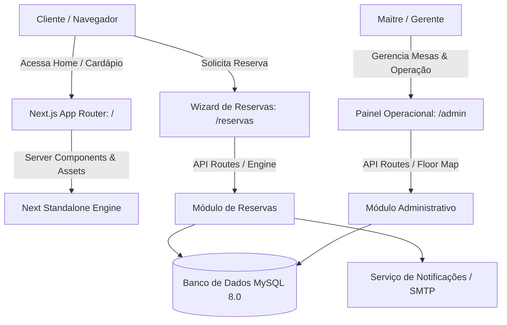

# Arquitetura do Sistema

atualizado: 2026-09-02

## Visão Geral

O projeto foi migrado de uma landing page estática para uma aplicação completa em **Next.js (App Router) + MySQL**, mantendo rigorosa paridade visual 1:1 na home e introduzindo os módulos completos de Reservas Públicas e Painel Administrativo Operacional.

## Estrutura de Diretórios (`next-app/`)

- **`next-app/src/app/`**:
  - `page.tsx`: Home institucional (Server Components + Client wrappers para interações).
  - `layout.tsx`: Layout base com metadados, preloads, fontes e provedores.
  - `reservas/page.tsx`: Wizard público de reserva em etapas.
  - `admin/page.tsx`: Painel administrativo com planta interativa e relatórios de ocupação.
  - `api/`: Route handlers para disponibilidade, criação de reservas, bloqueios e configurações.
- **`next-app/src/modules/`**:
  - `reservations/`: Regras de negócio, cálculo de horários/turnos, validação de capacidade e repositórios.
  - `admin/`: Gestão de mesas, planta baixa, bloqueios de turnos e configuração de e-mail.
- **`next-app/src/components/`**:
  - `admin/`: Componentes visuais do painel (planta de mesas, filtros de status, tabelas de reservas).
  - `reservation/`: Wizard de etapas, seletores de data/horário e resumos.
  - `layout/`: Header, footer, menus mobile e modais.
- **`next-app/src/behaviors/`**: Lógicas de cliente desacopladas (menu flipbook, animações, accordion).
- **`next-app/scripts/`**: Migrations de banco de dados (`migrate.mjs`) e seeds (`seed-local-restaurant.mjs`).

## Camadas e Padrões de Domínio

1. **Disponibilidade e Concorrência**: O motor de reservas aloca mesas automaticamente considerando a capacidade máxima da mesa versus o número de convidados e aplica travas transacionais no MySQL para impedir overbooking.
2. **Planta Operacional**: O painel administrativo expõe o mapa físico do salão com status em tempo real (livre, reservada, ocupada, bloqueada).
3. **Paridade Visual 1:1**: A versão legado (`index.html` e `style.css`) foi preservada em `next-app/legacy/` e validada por testes automatizados do Playwright.
